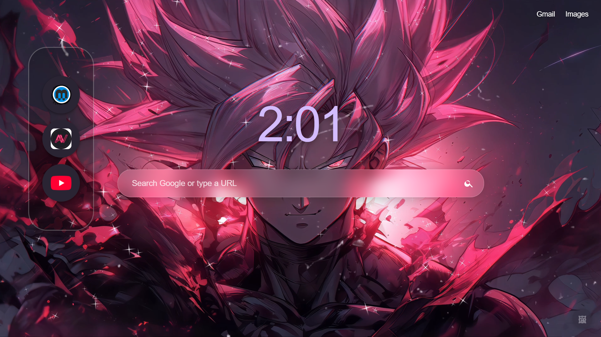
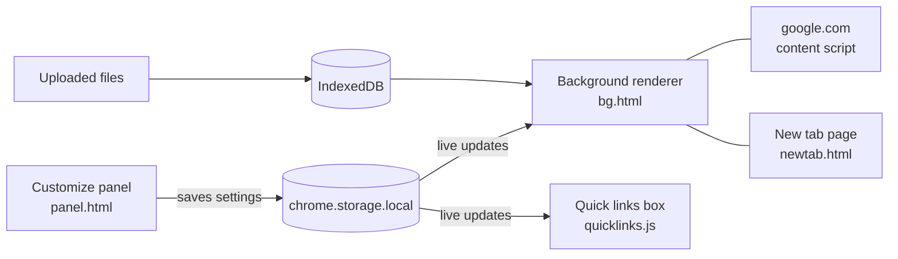

# Chrome-customizer
<h1 align="center">Chrome Customizer</h1>

<p align="center">
  Turn Google's homepage and your new tab into <i>your</i> space.<br>
  Animated backgrounds, a slideshow, a floating quick links box, and a clock above the search bar.
</p>

<p align="center">
  
  
  
</p>

<!-- ============================================================
     SCREENSHOT
     Put your finalresult.png in the same folder as this README.md
     (the root of the repo) and it will show up below.
     ============================================================ -->

<p align="center">
  
</p>

<p align="center"><sub>My setup: custom background, translucent search bar and my quick links box.</sub></p>

---

## ✨ What it does

| | |
|---|---|
| 🖼️ **Custom backgrounds** | Use a colour, an image, a **GIF**, or an **MP4/WebM video**. Paste a link or upload a file. |
| 🎞️ **Slideshow** | Mix images, GIFs and videos, put them in your order, and let it play. At the end it starts over from the first one. |
| 🎯 **Choose what part shows** | When a picture doesn't fit the screen, drag it to pick the part you want. Scroll to zoom. |
| 🔗 **Quick links box** | A floating box of site icons. Add as many as you want, then move and resize the box. |
| 🕒 **Logo or clock** | Above the search bar, show the Google logo, hide it, fade it, or swap it for the time (also faded if you like). |
| 🪟 **Translucent search bar** | The new tab's search bar is frosted glass, so your background shows through. |
| 🧹 **No clutter** | Hides the "Canada / Advertising / Business / Privacy / Terms" bar at the bottom of google.com. |
| 🔄 **Everything stays in sync** | Your links, background and settings are shared between google.com and the new tab page. |

It runs in two places:

- **The new tab page**: a Google-style page with a search bar, Gmail and Images links, your quick links box and your background.
- **google.com**: the same quick links box and background on Google's real homepage (works on `google.com` and `google.ca`, including `?safe=active` style URLs).

---

## 🚀 Install

You don't need the Chrome Web Store. It loads straight from the folder.

1. **Download** this repo (green **Code** button → **Download ZIP**) and unzip it, or run:
   ```bash
   git clone https://github.com/<your-username>/<your-repo>.git
   ```
2. Open `chrome://extensions` in Chrome.
3. Turn on **Developer mode** (top right).
4. Click **Load unpacked** and select the folder that contains `manifest.json`.
5. Open a new tab. Chrome may ask if you want to keep the extension's new tab page. Choose **Keep it**.

> **Updating?** Replace the files in your folder, then click the reload arrow on the extension at `chrome://extensions`. Your links, background and slideshow are kept.

Works in Chrome and other Chromium browsers that support Manifest V3.

---

## 🎛️ How to use it

### The Customize panel

Click the small **🖼️** button in the bottom-right corner of the new tab page or google.com. It starts faint and lights up when you hover over it.

**Background tab**

- **Type: Single**
  - **Colour**: pick a colour.
  - **Link**: paste a *direct* link to an image, GIF or MP4.
  - **Upload**: choose a file from your computer (up to 200 MB).
- **Type: Slideshow**
  - Add several images, GIFs or videos at once, or paste links.
  - Reorder with ▲ ▼, remove with ✕.
  - Choose how many seconds each image or GIF stays. Videos play until they end.
  - After the last slide it loops back to the first, with a fade between slides.
- **Size** (for pictures and videos)
  - **Fill**, **Fit inside** or **Stretch**.
  - **Zoom** slider.
  - **✋ Drag to choose what part shows**: drag the picture around, scroll to zoom, press **Done**.
- **Darken**: dims the background so text stays easy to read over bright pictures.

**Page tab**

- **Google (Above the search bar)**: Google logo, Hidden, Translucent logo, Time, or Translucent time.
- **Hide the bottom bar**: removes the footer on google.com (turn it off any time to bring it back).

### The quick links box

**Right-click the box** to open its menu:

| Menu item | What it does |
|---|---|
| **Add link** | Type a site like `youtube.com` and its icon appears. There is no limit. |
| **Delete** | Red ✕ badges appear on every icon. Click one to remove it. |
| **Move / Resize** | Drag the box anywhere, or drag the purple corner to resize it. Icons grow, shrink and wrap to fit. |
| **Reset position** | Puts the box back where it started. |

Press **Done** when you finish editing. Once there are too many icons to fit at the smallest size, the box scrolls.

---

## 🧠 How it works



- **One background engine, two pages.** `bg.html` draws the colour, image, GIF, video or slideshow. The new tab page and google.com both show it inside an iframe, so there is a single copy of the code and the two pages always match.
- **The panel is an extension page too.** `panel.html` runs in its own iframe, which means it can save uploaded files directly into the extension's storage.
- **Live sync.** Every setting is saved in `chrome.storage.local`. Anything that changes it (the panel, dragging the picture, the zoom wheel) updates every open tab right away.
- **Big files stay local.** Uploaded images, GIFs and videos are stored in the extension's own IndexedDB (the extension asks for `unlimitedStorage` so large files fit).
- **Drag to reposition.** While you drag, the page sends small messages to the background iframe, which moves the picture and then saves the position.
- **Making google.com see-through.** When a custom background is on, the content script makes Google's own page layers transparent so your background shows behind the search page.
- **The bottom bar and the logo.** Google's footer is found by its link text and country line, and its logo by its image or label, instead of fragile class names. A small observer re-checks them as Google draws the page.
- **Slideshow.** Items are loaded one at a time and crossfaded. Images use a timer, and videos advance when they finish.

### Project structure

```
├── manifest.json     Extension config (Manifest V3)
├── shared.js         Settings, file storage and the media loader
├── bg.html / bg.js   Background renderer (colour, image, GIF, video, slideshow)
├── panel.html / .js  The Customize panel (tabs, controls)
├── host.js           Adds the background, 🖼️ button, panel and drag mode to a page
├── quicklinks.js     The quick links box
├── content.js        google.com only: transparency, footer hiding, logo or time
├── newtab.html/.css/.js   The new tab page
└── finalresult.png   Screenshot used in this README
```

---

## ⚙️ Tweaking it

- **Other Google domains:** add them to `content_scripts → matches` and `web_accessible_resources → matches` in `manifest.json` (for example `https://www.google.co.uk/`).
- **Defaults:** every default setting lives in the `DEFAULTS` object in `shared.js`.
- **Colours:** the accent purple is `#8e6bd8` and the default new tab colour is `#3f3750`. Search for them to restyle.

---

## 🔒 Privacy

- There is **no analytics, tracking or account**. Your links, settings and uploaded files stay in your browser.
- The extension only runs on the new tab page and on `google.com` / `google.ca`.
- Site icons in the quick links box come from Google's favicon service (`google.com/s2/favicons`), so the domain of each link you add is requested from Google to get its icon.
- A background set by link is loaded from whatever site hosts it.

Permissions used: `storage` and `unlimitedStorage`.

---

## 🩹 Good to know

- **Chrome's own footer on the new tab.** Chrome adds a small bar under extension-made new tab pages with the extension name and a **Customize Chrome** button. An extension can't remove it, but you can: right-click the bar and choose **Hide footer on New Tab page**.
- **Direct links only.** Use a link that goes straight to the image, GIF or video (usually ending in `.gif`, `.png`, `.jpg`, `.mp4` or `.webm`), not a page that shows it. Some sites block other sites from using their files. If a link won't load, download the file and use **Upload**.
- **Video formats.** MP4 (H.264) and WebM work best. Videos play muted and loop.
- **Google can change its homepage.** The logo and footer are found by text and labels, which is sturdier than class names, but if Google redesigns the page something may stop matching. Please open an issue and say what you see.
- **The new tab "Google" logo is plain text**, styled to fit, not Google's image.
- **The clock** is 12-hour, like `3:07`.

---

## 🛠️ Troubleshooting

| Problem | Try this |
|---|---|
| The new tab is still Chrome's default | Check the extension is on at `chrome://extensions` and that you chose to keep it when Chrome asked. |
| Nothing shows on google.com | Reload the page. Make sure the address is `google.com` or `google.ca`, and that the extension was reloaded after an update. |
| A video or GIF won't load from a link | Use a direct file link, or download it and use **Upload**. |
| A file won't upload | Keep it under 200 MB. MP4 (H.264) and WebM are the safest. |
| I can't find the 🖼️ button | It's in the bottom-right and faint until you hover. It sits near the corner, above where Google's footer was. |
| I want everything back to normal | Open the panel and press **Reset everything**. |

---

## 📜 License

Add the license you want here (for example MIT) and include a `LICENSE` file in the repo.

---

<sub>Google is a trademark of Google LLC. This project is not affiliated with, endorsed by, or sponsored by Google.</sub>